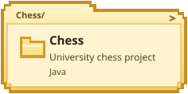
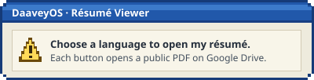

```text
==> Booting DaaveyOS
[  OK  ] Root filesystem mounted
[  OK  ] User session started
[  OK  ] Desktop and project directory ready

DaaveyOS login: deivis

     ┌───────────┐
     │           │   Deivis: 
     │   ⚪  ⬛  ⚪   <says> Welcome to DaaveyOS.
     └───────────┘

deivis@daaveyos:~$ whoami
[session] Opening the local profile in a desktop window…
```


[](https://www.linkedin.com/in/david-munoz44/)
[](#user-content-daaveyos-projects)
[](#user-content-daaveyos-resume)

```text
[session] Profile window closed. Back at the shell.

     ┌───────────┐
     │    ︵  ‿  ︵   Deivis: Let's check the work log.
     └───────────┘

deivis@daaveyos:~$ cat ~/work/madr.log
[role] Webmaster · Ministry of Agriculture and Rural Development
[ops]  Manage the TYPO3 portal, handle GLPI tickets, and document changes.
[seo]  Mapped 591 URLs to TYPO3 records and helped verify metadata updates.

deivis@daaveyos:~$ fastfetch

      ___           ___            deivis@daaveyos
     /__/\         /  /\           ---------------------------
    |  |::\       /  /::|          Desktop  CachyOS / Hyprland
    |  |:|:\     /  /:|:|          Shell    Zsh and Bash
  __|__|:|\:\   /  /:/|:|__        Lab      Raspberry Pi 5 + Linux
 /__/::::| \:\ /__/:/ |:| /\       Services Docker containers
 \  \:\~~\__\/ \__\/  |:|/:/       Network  Tailscale + VPS tunnel
  \  \:\           |  |:/:/        Config   Git + GNU Stow
   \  \:\          |  |::/         Work     TYPO3 + GLPI
    \  \:\         |  |:/          Focus    Linux infrastructure
     \__\/         |__|/

deivis@daaveyos:~$ ls ~/projects
[file-manager] Opening Projects. Select a folder to continue.
```

<a name="daaveyos-projects"></a>

<table>
  <tbody>
    <tr>
      <td align="center"><a href="./homelab-glud.md"></a></td>
      <td align="center"><a href="https://github.com/Deivis44/dotfiles"></a></td>
      <td align="center"><a href="https://github.com/Deivis44/Chess"></a></td>
    </tr>
  </tbody>
</table>

```text
deivis@daaveyos:~$ ls ~/toolkit
```


<a name="daaveyos-resume"></a>

```text
deivis@daaveyos:~$ resume --select-language
[resume] Waiting for a language selection…
```
<p align="center">
  
  <br>
  <a href="https://drive.google.com/file/d/1QdnVJ5_DsU1IcL51GRcbPfRWgP4Drwpd/view"></a>
  <a href="https://drive.google.com/file/d/14UhDydrfdGKyDjekTmb9QbbDNQS49qJc/view"></a>
</p>

```text
     ┌───────────┐
     │           │   Deivis: 
     │   ⚪  ‿  ⚪   <says> See you around. The shell is yours.
     └───────────┘

deivis@daaveyos:~$ █
```
