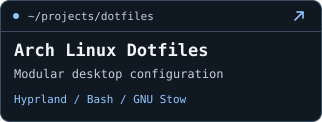
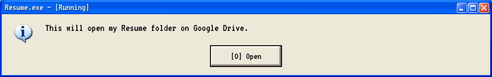

```text
==> Booting DaaveyOS
[  OK  ] Root filesystem mounted
[  OK  ] User session started
[  OK  ] Desktop and project directory ready

DaaveyOS login: deivis

     ┌───────────┐
     │           │   Deivis: 
     │   ⚪  ⬛  ⚪   <says> Welcome to DaaveyOS.
     └───────────┘

deivis@daaveyos:~$ whoami
[session] Opening the local profile in a desktop window…
```


```text
[session] Profile window closed. Back at the shell.

     ┌───────────┐
     │    ︵  ‿  ︵   Deivis: Let's check the work log.
     └───────────┘

deivis@daaveyos:~$ cat ~/work/madr.log
[role] Webmaster · Ministry of Agriculture and Rural Development
[ops]  Manage the TYPO3 portal, handle GLPI tickets, and document changes.
[seo]  Mapped 591 URLs to TYPO3 records and helped verify metadata updates.

deivis@daaveyos:~$ fastfetch

      ___           ___            deivis@daaveyos
     /__/\         /  /\           ---------------------------
    |  |::\       /  /::|          Desktop  CachyOS / Hyprland
    |  |:|:\     /  /:|:|          Shell    Zsh and Bash
  __|__|:|\:\   /  /:/|:|__        Lab      Raspberry Pi 5 + Linux
 /__/::::| \:\ /__/:/ |:| /\       Services Docker containers
 \  \:\~~\__\/ \__\/  |:|/:/       Network  Tailscale + VPS tunnel
  \  \:\           |  |:/:/        Config   Git + GNU Stow
   \  \:\          |  |::/         Work     TYPO3 + GLPI
    \  \:\         |  |:/          Focus    Linux infrastructure
     \__\/         |__|/

deivis@daaveyos:~$ ls ~/projects
[file-manager] Opening Projects. Select a folder to continue.
```

[](./homelab-glud.md)
[](https://github.com/Deivis44/dotfiles)

[Chess](https://github.com/Deivis44/Chess) · University project in Java

```text
deivis@daaveyos:~$ contact --help
Open LinkedIn to get in touch, or browse the résumé archive.
```

[](https://www.linkedin.com/in/david-munoz44/)

<details>
<summary><code>resume --archive</code> · Archived résumés</summary>

```text
deivis@daaveyos:~$ resume --archive
[session] Opening the résumé archive…
```

Archived PDFs from February 2025.

[](https://drive.google.com/drive/folders/1oYNx0hEfAhGNUxD47JWJN1M44ndzPiUd?usp=sharing)

</details>

```text
     ┌───────────┐
     │           │   Deivis: 
     │   ⚪  ‿  ⚪   <says> See you around. The shell is yours.
     └───────────┘

deivis@daaveyos:~$ █
```
