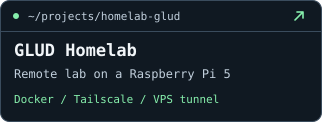

```text
==> DaaveyOS boot sequence initiated
==> Session ready · deivis@daaveyos

     ┌───────────┐
     │           │   Deivis: 
     │   ⚪  ⬛  ⚪   <says> Welcome to |DaaveyOS| v22.9.25, user!
     └───────────┘
```

### `deivis@daaveyos:~$ whoami`

```text
David Santiago Muñoz Fernández
Systems Engineering student · Universidad Distrital
Webmaster · Colombia's Ministry of Agriculture and Rural Development
Bogotá, Colombia · Open to internships and junior roles
Focus: Linux systems administration, IT infrastructure, and DevOps
```

### `deivis@daaveyos:~$ ls ~/projects`

[](./homelab-glud.md)
[](https://github.com/Deivis44/dotfiles)

[Chess](https://github.com/Deivis44/Chess) · University project in Java

### `deivis@daaveyos:~$ cat ~/work/madr.log`

I administer the Ministry's portal in TYPO3, handle GLPI tickets, and document publication changes. For a technical SEO project, I mapped **591 URLs** to TYPO3 records and helped verify metadata updates.

### `deivis@daaveyos:~$ contact --help`

[](https://www.linkedin.com/in/david-munoz44/)
[](https://drive.google.com/drive/folders/1oYNx0hEfAhGNUxD47JWJN1M44ndzPiUd?usp=sharing)

### `deivis@daaveyos:~$ fastfetch`

```text
      ___           ___            deivis@daaveyos 
     /__/\         /  /\           
    |  |::\       /  /::|          OS  Linux 6.11.5-arch1-1
    |  |:|:\     /  /:|:|          Host  DaaveyOS Professional Workstation
  __|__|:|\:\   /  /:/|:|__        Kernel  6.11.5-arch1-1
 /__/::::| \:\ /__/:/ |:| /\       Uptime  Learning since 2020
 \  \:\~~\__\/ \__\/  |:|/:/       Shell  zsh 5.9
  \  \:\           |  |:/:/        DE  Hyprland (Wayland)
   \  \:\          |  |::/         CPU  Always processing new ideas
    \  \:\         |  |:/          Memory  Constantly expanding knowledge
     \__\/         |__|/           GPU  Rendering creative solutions

```

<details>
<summary><code>journalctl -b</code> · Full boot log</summary>

```text
==> Booting DaaveyOS [profile]
/dev/sda3: recovering journal
/dev/sda3: clean, 238075/59965440 files, 6019093/239842481 blocks

  --> Starting system initialization...

[    0.01s] :: Loading kernel modules
[    0.03s] :: Initializing hardware detection
[    0.05s] :: Starting udev daemon
[    0.07s] :: Mounting filesystems
[    0.09s] :: Loading network interfaces
[    0.12s] :: Starting system services

==> Login successful. Welcome back, Deivis!

```

</details>

```text
deivis@daaveyos:~$ resume --download

     ┌───────────┐
     │    ︵  ‿  ︵   Deivis:
     │           │   <thinking> 
     └───────────┘

     ┌───────────┐
     │           │   Deivis: 
     │   ⚪  ⬛  ⚪   <says> Handing control to the Resume window.
     └───────────┘
```

[](https://drive.google.com/drive/folders/1oYNx0hEfAhGNUxD47JWJN1M44ndzPiUd?usp=sharing)

```text
     ┌───────────┐
     │           │   Deivis: 
     │   ⚪  ‿  ⚪   <says> Feel free to reach out after reviewing my experience!
     └───────────┘

deivis@daaveyos:~$ █
```
