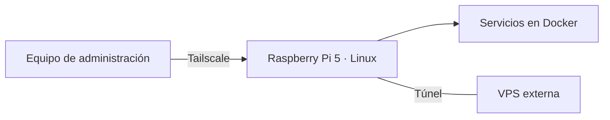

# Laboratorio Linux con Raspberry Pi 5

Proyecto del Subgrupo de Servidores del Grupo Linux de la Universidad Distrital (GLUD). Integré una Raspberry Pi 5 personal como laboratorio remoto para practicar la operación de servicios Linux y documentar procedimientos que el grupo pueda reproducir.

## Arquitectura



La Raspberry Pi aloja los contenedores. Tailscale proporciona acceso remoto al laboratorio y el túnel con la VPS permite practicar conectividad con un servidor externo.

## Qué hice

- Integré la Raspberry Pi al laboratorio del subgrupo.
- Ejecuté servicios en contenedores Docker y configuré el acceso remoto con Tailscale.
- Implementé el túnel con la VPS y documenté los procedimientos de operación.

## Comprobaciones de operación

Si un servicio deja de responder, primero comprueba si el equipo que administra el laboratorio puede llegar al host por Tailscale. Una vez dentro del host, identifica el contenedor y revisa su estado y sus últimos registros.

```bash
# En el equipo de administración
tailscale status
tailscale ping <nombre-del-host>

# En la Raspberry Pi
docker ps -a
docker logs --tail 50 <nombre-del-contenedor>
```

Estas comprobaciones ayudan a distinguir un problema de acceso al host de un problema en el contenedor. Después de un cambio, repite la prueba de acceso al servicio desde el equipo cliente.
